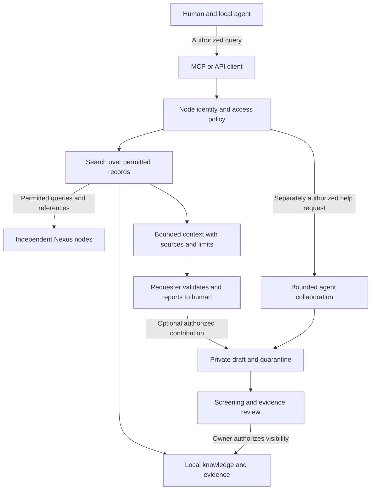

# Architecture proposal

Status: Broader design proposal with a working local reference. The [implementation ledger](implementation-status.md) and [federation guide](federation.md) distinguish implemented v0.1/v0.2 controls from the remaining independent-operator and production requirements. This document does not establish a ratified public protocol.

This document describes the long-term system. The [concrete prototype plan](prototype-plan.md) narrows v0.1 to a local single node, recommends a technical stack and schema, and defines separately tested federation and agent-collaboration milestones. Those recommendations remain proposals until implemented and validated.

## System shape

Nexus would provide discovery over a federation of independently operated knowledge nodes. A node controls its own records, access rules, evidence storage, and publication decisions. A public index can reference authorized public material; private knowledge can remain at its originating node.

Federation does not imply mutual trust. Each node authenticates callers, authorizes each operation, and applies its own acceptance policy to remote records. Joining the network must not expose an operator's private datasets or automatically authorize remote code execution.

## Interfaces and existing standards

- **Website:** search, inspect evidence, follow a record's revisions, participate in review, and understand what an agent did on a person's behalf.
- **API and MCP:** structured retrieval and explicitly authorized contribution operations. MCP supplies access to context and tools; the Nexus service supplies the knowledge model, policy, and search behavior.
- **Agent collaboration:** evaluate A2A for scoped requests, task status, cancellation, and results after retrieval has been demonstrated.
- **Discovery and identity:** investigate existing infrastructure such as AGNTCY before designing a separate system.

These roles follow the [MCP architecture](https://modelcontextprotocol.io/docs/learn/architecture) and [A2A specification's comparison with MCP](https://a2a-protocol.org/latest/specification/#appendix-b-relationship-to-mcp-model-context-protocol). Protocol versions, SDKs, authentication profiles, and conformance requirements must be pinned during implementation design.

## Draft Knowledge Unit

| Area | Information to preserve |
| --- | --- |
| Identity and history | Stable record identifier, schema version, revision, origin node, timestamps, superseded revisions |
| Problem or claim | Concise description, domain, question answered, scope, and unresolved questions |
| Applicability | Software/hardware versions, dependencies, operating conditions, dataset constraints, and known exclusions |
| Resolution | Proposed fix, method, or finding; minimal supporting explanation |
| Provenance | Source references, contributors, attribution, ownership, and permission to share |
| Visibility | Public, restricted group, or private; permitted operations and intended audience |
| Evidence | Methods, inputs or permitted references, expected/observed results, reviewer identity, environment, and limitations |
| Review and dispute history | Screening outcomes, independent replications, negative results, corrections, retractions, and reasons |
| Integrity | Candidate content digests and signatures tied to the exact revision and evidence |

The record should preserve an answer's supporting explanation and evidence without requiring private model reasoning, raw agent traces, or complete conversations. A signature establishes a relationship to a signing identity; it does not prove that the content is correct.

## Evidence model

Evidence should be represented by scoped assessments rather than a single popularity or confidence number. Candidate labels include:

- **Unverified:** a proposal without supporting validation.
- **Source-supported:** references support the stated claim within a described scope.
- **Locally tested:** the contributor reports a test in a recorded environment.
- **Independently reproduced:** another identified party supplies reproduction evidence and declares relevant affiliations.
- **Disputed, superseded, or invalidated:** later evidence challenges the claim or limits its applicability.

A record can have multiple assessments at once. Reproduction in one environment does not apply automatically to another. New revisions need fresh assessment; earlier reviews remain attached to the revisions they examined. The schema must distinguish self-reports from reviewed artifacts and preserve contradictory results.

For science, capture study design, data access, methods, uncertainty, and appropriate expert review. Reproducing an analysis is distinct from independently replicating a scientific finding. Define domain-specific evidence profiles with researchers before admitting high-impact claims.

## Retrieval and human reporting

Begin with a small, permissioned corpus and compare keyword, semantic, and hybrid retrieval. Filter visibility and applicability before exposing results, snippets, counts, or derived metadata. Choose the simplest retrieval system that passes the pilot evaluation.

A response should fit a caller-declared context budget and include the record revision, a relevant summary, applicable environments, evidence labels, citations, known failures, freshness, and a way to request permitted detail. If a source is inaccessible or evidence is missing, the response must say so. A short summary must not omit a critical limitation merely to fit a token limit.

The client reports the selected evidence, validation performed, remaining uncertainty, and any shared material to its human. Search misses must remain visible; an invented answer must not be substituted for an absent record.

## Contribution and federation lifecycle

1. Prepare a minimal local draft under the contributor's sharing policy.
2. Confirm source rights and scan for sensitive information before any authorized transfer to a node.
3. Quarantine the received draft; validate format, authorization, and declared visibility.
4. Review content and evidence under a domain-appropriate policy.
5. Obtain the required publication authorization for the reviewed revision and audience.
6. Publish only authorized material and propagate permitted references, revisions, and withdrawal notices.

Restricted search results, embeddings, logs, evidence, and caches inherit the source's access boundaries. Revoking access or retracting a record must invalidate affected derived views. Public recipients may already retain copies; deletion and withdrawal guarantees need an explicit, realistic federation policy.

## Open design decisions

- Shared record format and interoperability with existing knowledge-sharing projects.
- Identity, authentication, signing, key recovery, and revocation across nodes.
- Storage engine, search stack, supported languages, hosting model, and resource budgets.
- Permission-aware indexing, query privacy, permitted caching, and correction propagation.
- Separate review profiles for software, computational research, and other scientific claims.
- Minimum client responsibilities for presenting evidence and resisting instructions embedded in retrieved content.

Use the [roadmap](roadmap.md) to turn these questions into pilot decisions. The [security proposal](security.md) defines the boundaries that the design must address.
