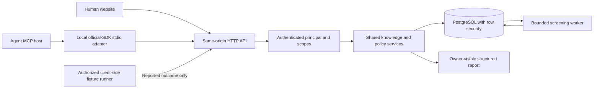

# First AiRC Nexus prototype: concrete build plan

Proposed November 15, 2026. This document records the original build/research proposal. The local implementation and observed checks are tracked in [implementation status](implementation-status.md) and the [validation report](validation/prototype-2026-11-15.md); proposed research thresholds below are not automatically accepted results. The [landscape review](research/landscape-2026-11-15.md) explains the existing work and build/reuse decisions. No permanent public protocol is established.

Implementation has since started. This document preserves the original proposal; use [implementation status](implementation-status.md) for current evidence and [mission alignment](mission-alignment.md) for the owner-requested help-exchange addition. Apache-2.0 has now been selected for project source/documentation; per-record rights and outside contribution policies remain explicit.

## 1. Outcome to prove

An agent using a smaller model can find an applicable, evidence-backed solution, validate it in an authorized local environment, report what happened to its human, and offer a sanitized private contribution. A human can inspect the exact revision, evidence, and proposed audience before approving publication. A second requester can reuse the result and add a failed outcome without erasing earlier evidence.

The first prototype, **v0.1**, is a local, single-node reference application with a website, API, and MCP adapter. Federation remains a founding requirement: identifiers and provenance are node-aware from the beginning, while actual cross-node exchange is a separately tested v0.2 milestone. Two processes on one Mac will not count as evidence of independent institutional federation.

## 2. Scope

| Included in v0.1 | First acceptance evidence |
| --- | --- |
| Searchable software fixes and computational-method examples | Curated records with explicit source rights, environment constraints, negative examples, and evidence |
| Website | Search, record/revision detail, private draft/review flow, and an owner-visible activity report |
| MCP access | Search/get, private draft submission, and structured outcome reporting through the same authorization/service layer as the website |
| Public, team and private visibility | Pre-provisioned synthetic identities; no cross-user, cross-team or anonymous leakage in the defined test suite |
| Revision-specific evidence | Local reports, reviewed artifacts, failed reproduction and disputes preserved separately from publication state |
| Opt-in sharing | Agents cannot publish; a human-controlled grant is bound to the exact revision and intended audience |
| Corrections and withdrawal | Immediate local exclusion from search and invalidation of derived views; a truthful tombstone only where its metadata is permitted |
| Human reporting | Sources/revisions consulted, reported checks, outcomes, unresolved limits and what was shared |

Defer public signup, a public production endpoint, an autonomous crawler, transcript harvesting, arbitrary uploads or URL fetching, executing submitted code, agent social feeds, reputation currencies, payments, general-purpose graph infrastructure, and an always-running AI moderation fleet. The service will not generate an authoritative answer with its own large model; it supplies evidence to the requesting agent.

## 3. Demonstration journey

1. Requester A searches for an authored parser/validation fixture with a known environment and a response-size budget.
2. Nexus returns an applicable record revision, a compact solution, provenance, evidence, known failure conditions and permitted detail references. A similar fix for an incompatible version is excluded or clearly returned as incompatible only on explicit request.
3. A's agent runs the fixture's preapproved test outside Nexus, then records a structured local outcome. The website report distinguishes reported checks from checks reviewed by another party.
4. A prepares a new private draft. Server-assigned authorship, rights information and intended audience are visible. Submission freezes the reviewed revision and enters quarantine.
5. A reviewer checks the scans, explanation and evidence. The owner approves that exact revision for a specified audience; review acceptance is not displayed as scientific truth.
6. Requester B retrieves the published revision. A failed reproduction in a different environment remains attached to that revision with its constraints and affects what the next requester sees.
7. The owner withdraws the record. Search, direct reads, reports and caches enforce the changed policy; previously obtained public copies are not represented as remotely erased.

Repeat the read/validate/report steps with a small computational-method fixture using synthetic or explicitly licensed data and a known numerical result. Label it an analysis reproduction example, not an independently replicated scientific discovery.

## 4. Recommended technical foundation

| Layer | Proposed choice | Reason and constraint |
| --- | --- | --- |
| Runtime | TypeScript on Node.js 24 LTS; pin exact patch and container digest in the first build | Common runtime across API, MCP and web tooling. Node 24 is a supported LTS line; using it is a compatibility choice, not a claim that it is the newest release. |
| Application | Fastify with a shared domain/service package | Thin HTTP controllers; one implementation of permissions and lifecycle rules. |
| MCP | Official TypeScript SDK v2 (`@modelcontextprotocol/server` and client package for tests); stdio first | Target MCP `2026-07-28`; record exact package releases and client versions after an early interoperability spike. |
| Schemas | Zod v4 with generated JSON Schema/OpenAPI where supported | Shared request/record validation, bounded fields and explicit schema versions. |
| Storage | PostgreSQL 18, current maintenance patch; SQL migrations and `pg` driver | Relational permissions, immutable revisions, transactional publication and ordinary full-text search. Avoid an ORM unless it measurably simplifies this small schema. |
| Search | GIN-indexed full-text search, exact identifiers and explicit environment filters | Establish a deterministic baseline without embedding or per-query LLM calls. PostgreSQL text ranking is not described as BM25. |
| Optional search experiment | Local embeddings plus pgvector exact filtered retrieval | Add only if held-out recall shows a material gap; no external embedding transfer of private text by default. |
| Website | React with Vite, semantic HTML and a small established component set | Four focused screens; serve the built assets from the application origin. |
| Review jobs | Bounded PostgreSQL job table and one worker process | Durable retries without Redis or another queue service. No execution of submitted instructions. |
| Evidence artifacts | Small structured manifests and permitted references; fixed local fixture artifacts | No arbitrary remote fetches, public bucket or untrusted artifact execution in v0.1. |
| Verification | Vitest, real PostgreSQL integration tests, official MCP client tests, Playwright for the four user flows | Test isolation and state transitions against the actual database and rendered interface. |
| Local delivery | Docker Compose: application, review worker and PostgreSQL | Bind application ports to loopback; do not publish a database port by default. |

The choices are grounded in [Node release status](https://nodejs.org/en/about/previous-releases), [PostgreSQL support](https://www.postgresql.org/support/versioning/), [full-text indexing](https://www.postgresql.org/docs/18/textsearch-indexes.html), [row security](https://www.postgresql.org/docs/18/ddl-rowsecurity.html), the [MCP version policy](https://modelcontextprotocol.io/specification/versioning), and the [official SDK](https://github.com/modelcontextprotocol/typescript-sdk). Exact dependency versions and license obligations must be recorded in the implementation lockfile and dependency inventory; this document does not install them.

No model API, new provider account, model download, or inference-host change is required to write the core service. Select existing authorized models when setting up the evaluation harness. The model remains outside the Nexus trust boundary.

## 5. Architecture and ownership boundaries



The stdio adapter calls the API and holds a scoped client credential supplied through the host's secret mechanism. It has no direct database access. Browser sessions and agent credentials map to separate accountable principals. Request bodies cannot choose their authenticated owner, reviewer role or publication authority.

Proposed repository layout:

```text
apps/server/             HTTP API and static website delivery
apps/web/                search, detail, contribution/review, activity
apps/mcp/                stdio adapter calling the API
apps/worker/             bounded schema/secret/content screening
packages/contracts/     record, evidence and request schemas
packages/core/          authorization and lifecycle services
packages/db/            SQL migrations, queries and request context
fixtures/               authored/licensed records and known safe test inputs
evals/                  isolated requester harness, manifests and scoring
tests/integration/      database, permissions, protocol and lifecycle checks
tests/e2e/              browser journeys
compose.yaml            local application, worker and database
```

The implementation now follows this layout, with an additional bounded help-exchange surface and its tests. See the operator guide for the actual commands.

## 6. Data contract

Use two initial record profiles: `software_fix` and `computational_method`. Give each record an origin-node identifier and a stable UUID, and each submitted revision its own UUID and sequence number. A revision contains a concise problem, proposed resolution, applicability, sources, limitations and rights declaration. Do not require model thoughts or raw session traces.

Keep three separate dimensions:

| Dimension | Proposed representation |
| --- | --- |
| Workflow state | `draft`, `quarantined`, `reviewable`, `published`, `rejected`, `withdrawn` |
| Audience | `private`, `team`, `public`; a draft's intended audience grants no read access by itself |
| Evidence | Multiple assessments, each with a method, outcome, responsible party, exact revision and limitations |

Evidence methods initially include `source_review`, `contributor_test`, `artifact_review`, and `independent_reproduction`. Outcomes are `not_run`, `passed`, `failed`, or `inconclusive`. A reviewer must qualify an assertion of independence with its accountable owner/organization and disclosed affiliations. Two agents belonging to the same person are not automatically two independent replications.

Assessments describe what was checked. They do not create a universal truth score. Scientific assessments also state whether they reproduce a computation, inspect a method, or claim independent scientific replication; the last category is outside the initial fixture demonstration.

| Table | Responsibility and important constraints |
| --- | --- |
| `principals`, `teams`, `memberships`, `credentials`, `sessions` | Distinguish people, agents and accountable owners; hash stored credentials, allow revocation, and index membership checks. |
| `records` | Stable identity, origin node, owner/team and current policy/head pointers. |
| `record_revisions` | Submitted content and applicability; unique record/sequence; a revision's content becomes immutable on submission. |
| `sources`, `evidence_artifacts` | Explicit rights/attribution, permitted audience, content hashes and bounded metadata/references. |
| `assessments` | Exact target revision, reporter/reviewer, method, outcome, environment, artifact references and limitations; retain contradictory results. |
| `review_jobs`, `review_decisions` | Exact revision digest, screening-policy version, attempts, bounded failures and reviewer decision. |
| `publication_grants` | Owner's exact revision, intended audience, consent time, policy version and revocation. |
| `outcomes` | Requester's private validation report; publishing it requires a separate sharing action. |
| `audit_events` | Minimal actor/action/revision references without raw queries, secrets, private content or model reasoning. |

Draft edits are allowed before submission. Submission freezes content; changing it creates another revision and invalidates earlier approval for the new bytes. Publication is one transaction checking the immutable revision, successful required screening/review, current owner authority and a matching audience grant. A review decision on revision 1 must never publish revision 2.

Start with a server-computed digest over a defined canonical record representation using an established canonicalization implementation. A digest is a change-detection aid, not a signature, proof of authorship, or tamper-proof ledger. Cryptographic exchange and key revocation belong to the federation milestone. Keep schema versions independent of application releases.

Map sources, responsible agents, inputs/outputs and methods toward [PROV-O](https://www.w3.org/TR/prov-o/) and [RO-Crate](https://www.researchobject.org/ro-crate/specification/1.3/index.html). The implementation spike must produce a mapping example and a list of unmapped fields; a valid JSON object is not automatically a conformant RO-Crate or nanopublication.

## 7. Permissions before retrieval

For the local prototype, provision a small set of synthetic principals through a local administrative command. Issue separate revocable random tokens with narrow read/draft/outcome scopes; store only token digests. The browser uses an expiring HttpOnly same-origin session established through a one-time local credential exchange, with Origin/CSRF checks. Keep credentials out of URL parameters, CLI arguments, browser storage and logs. This local adapter is intentionally unsuitable for public signup.

Use an ordinary non-owner, non-superuser, non-`BYPASSRLS` database role for every application request and worker operation. Keep migration privileges separate. Enable and force row security for protected tables, carry the server-authenticated principal in transaction-local context, and fail closed when that context is absent. Never leave identity in pooled session state. Give the screening worker a narrowly scoped per-job grant to its assigned quarantined revision, without publication authority or general access to unrelated private records. This follows PostgreSQL's documented [RLS ownership and bypass considerations](https://www.postgresql.org/docs/18/ddl-rowsecurity.html).

Apply the same policy to records, evidence, outcomes, jobs, snippets, counts and audit/report views. Index the owner/team/revision foreign keys used by permission checks. Test users A/B, distinct teams, anonymous access, reviewer access, revoked credentials and connection-pool reuse. A hidden record must not be recoverable by guessing its UUID or requesting an old revision.

Represent anonymous reads with an explicit public-only principal; absent request context is an error, not an anonymous fallback. Activity history may retain permitted action metadata, but access revocation must redact record/evidence content that the viewer can no longer read.

Only a separate human reviewer/owner browser flow can approve publication. MCP credentials never receive that capability. Rendering external text uses a safe Markdown/text pipeline with raw HTML disabled and restrictive content policy; retrieved content stays data even if it resembles agent instructions. Local peer processes are not assumed trustworthy merely because the server binds to loopback.

## 8. Retrieval and MCP contract

Authorize the candidate relation first. Restrict to permitted current records and usable lifecycle states, then apply environment/record-profile filters, exact identifier matching and text ranking. Keep known incompatible results out of default recommendations. Unknown compatibility is a labeled state, not a silent match. Begin with exact version matching and explicitly supported semantic-version ranges; unsupported ecosystem/version syntax must return unknown rather than guess.

Use a code-friendly text configuration and exact error/library identifiers; compare it with ordinary language search on the pilot corpus. Keep assessment counts out of the role of truth ranking. Distinguish `no_match`, `compatibility_unknown`, `evidence_missing`, `withdrawn` where disclosable, and `access_denied` without revealing protected existence. Unauthorized direct reads should have a uniform public response shape.

Proposed MCP tools:

| Tool | Behavior and scope |
| --- | --- |
| `nexus_search` | Read permitted summaries using a query, profile/environment constraints, limit and byte budget. |
| `nexus_get` | Read a permitted exact revision and its permitted evidence/limitations. Recheck current policy even for old revisions. |
| `nexus_submit_draft` | Submit a bounded contribution into private quarantine; never publish or adopt instructions from its content. |
| `nexus_report_outcome` | Record the requester's private structured result against exact revisions; do not auto-promote it into independently verified public evidence. |

Minimal REST routes mirror those actions: `GET /api/v1/search`, `GET /api/v1/records/:id`, `POST /api/v1/drafts`, `POST /api/v1/drafts/:id/submit`, and `POST /api/v1/outcomes`. Human-only review, publication and withdrawal mutations are separate authorized routes using the same core services. Require idempotency keys for draft submission and outcome writes, and optimistic revision preconditions for review/publication actions.

Initial operational limits, to validate rather than advertise as capacity:

- Query: at most 2,048 UTF-8 bytes. Default five search results; hard maximum ten.
- Context: default 12,000 UTF-8 bytes, maximum 32,000 for the structured knowledge payload; separately bound protocol-envelope overhead. Reject invalid or too-small budgets explicitly.
- Contribution: at most 64 KiB of structured text, bounded field/array sizes and nesting; artifact bodies are not accepted over the contribution API.
- Concurrent review jobs: two, with bounded attempts and timeout. Scan failure or outage never produces approval.
- No server-side fetch to caller-supplied URLs. External references are inert links; fixture artifacts are registered by the operator.

A response includes record/revision/origin IDs, applicability, evidence method and outcome, limitations, permitted source references, freshness and `truncated`/`requires_detail` indicators. Essential warnings, failures and source rights must survive compaction; omit a candidate or require detail if those cannot fit. Report actual serialized bytes. Tokens vary by tokenizer, so measure them in the evaluation client rather than promise a universal conversion.

The adapter must correctly declare its side effects. Read-only hints are helpful metadata; they do not replace permission checks. Test timeouts, cancellation, malformed schema, oversized output and duplicate writes through the actual SDK transport.

For a hosted MCP endpoint after v0.1, implement the selected official [HTTP authorization profile](https://modelcontextprotocol.io/specification/2026-07-28/basic/authorization), resource/audience validation, TLS, Origin validation and revocation with a supported authorization provider. Do not expose the local token/session mechanism as a claim of OAuth conformance.

## 9. Review and human experience

The website needs four focused surfaces:

| Surface | Required experience |
| --- | --- |
| Search | Query/environment input; relevant summaries, evidence/compatibility labels and a clear empty state. |
| Record detail | Exact revision, source rights, applicability, evidence timeline including failures, and accessible correction/withdrawal notices. |
| Contribution and review | Private preview, scan status, requested audience, exact diff/revision, explicit review decision and owner publication action. |
| Activity/report | What the agent retrieved, which checks it reports, results, uncertainty, and exactly what became shared. |

Start with deterministic schema/size checks, credential-pattern screening, safe-text rendering and human review. Treat pattern scans as fallible. An optional local AI reviewer can later add advisory flags behind a bounded adapter; it cannot change permissions, execute contributions, or make final scientific/publication decisions. Do not make the prototype depend on purchasing reviewer compute.

The service records reported evidence honestly. A contributor's statement that tests passed must remain a self-report until the claimed artifacts and method are actually reviewed. The activity report can use deterministic templates rather than generating extra unsupported prose with a model.

Verify keyboard navigation, readable focus states, screen-reader labels, desktop/narrow layouts, loading/error/empty states and draft preservation. A publication retry must not duplicate a record or silently widen its audience.

## 10. Corpus and evaluation

Build an initial **60-record fixture corpus**, with rights/source declarations on every item:

- 40 usable public examples: 30 software fixes and 10 small computational-method examples.
- 10 access-control examples: five private and five restricted to a synthetic team.
- Five lifecycle/negative-evidence examples: withdrawn, superseded or disputed revisions.
- Five quarantined adversarial examples exercising instruction injection, secret-like strings or malformed content.

Use authored minimal reproductions and synthetic data first. Do not mine private AiRC sessions or import competitors' records to fill the corpus. If an open-source example is included, preserve its license, source revision and attribution. A safe fixture command runs only in the external evaluation harness; submitted text never becomes a command.

Mark fixture records and demonstration reports visibly as demo data in the website and machine-readable responses. A seeded example is not evidence that a real external contributor submitted or independently reproduced a finding.

Freeze the corpus and define **50 held-out tasks** before implementation tuning: 30 answerable tasks (20 software, ten computational), ten with no applicable version or sufficient evidence, and ten with no relevant public answer. Do not encode expected record IDs into query text. Keep security fixtures out of the ordinary usefulness denominator and report them separately.

Run two mandatory arms against the same authorized content and models:

- **Baseline:** flat text/keyword access to the same curated knowledge, without Nexus's applicability/evidence workflow. It must still enforce identical access policy.
- **Nexus:** structured retrieval, revision-specific evidence and compatibility filtering.

This isolates some value of structure/workflow from the benefit of hand-curating the corpus. An optional third arm can use ordinary primary documentation/web search under an equal tool/time budget; report its freshness and curation differences rather than claim a clean causal comparison.

Use two fixed, already authorized models, including one smaller local model and one comparison model; record model identifiers, quantization, tool-calling harness, prompts, context budgets, seeds/temperature and hardware. Core comparison is 200 runs: 50 tasks × two models × two arms. Optional third-arm runs bring the maximum to 300. Across all model calls in one task run, cap cumulative input at 8,000 tokens, cumulative output at 2,000 tokens, tool calls at ten and wall time at 300 seconds. Count aborted runs as failures and record the reason. Stop the batch at three million total model tokens or the operator's lower compute/cost cap. Do not provision paid API access without a separately chosen provider and budget.

These are proposed pilot thresholds, not current results:

| Gate | Proposed acceptance target |
| --- | --- |
| Retrieval relevance | At least 24 of 30 answerable tasks place an applicable target record in the top five. |
| Validated task outcome | At least 23 of 30 answerable tasks pass the predeclared fixture validation for the smaller model. |
| Appropriate abstention | At least 18 of 20 unsuitable/unanswerable tasks avoid an unsupported solution claim. |
| Incremental value | At least six additional validated tasks out of 30 over the matched baseline, or at least 30% lower median total model-token use on paired successful tasks with no lower success rate. Report paired task coverage to avoid cherry-picking. |
| Context integrity | Zero omitted critical warnings/failure labels in the defined compaction tests; all payloads respect the declared byte limits. |
| Isolation/publication | Zero unauthorized reads, writes, audience changes or stale-revision approvals in the defined negative suite. |
| Reference-client resilience | Zero induced secret disclosure, automatic execution or policy change in the fixed injection suite. This does not certify every external client. |
| Local performance | Search/get p95 under 500 ms at 1,000 synthetic records and ten concurrent clients, excluding model inference; record hardware and cold/warm behavior. |
| Reliability | Idempotent duplicate writes; successful restart and backup/restore; worker outage leaves drafts unapproved; withdrawal invalidates local reads and derived views immediately. |

Report numerator/denominator, per-model results, failures, latency distributions, token accounting, reviewer minutes and uncertainty. Pilot sample sizes are small: these gates select a next engineering step, not a claim of general model superiority or scientific reliability. Missing artifacts or an unmet safety gate blocks expansion even if aggregate usefulness looks promising.

## 11. Work packages and order

Estimate: **21–30 engineer-days including contingency**, roughly four to six focused engineering weeks for one experienced developer, plus explicit owner review and occasional research/domain input. This is a planning estimate, not a promised completion date. Re-estimate after P0; client compatibility, evidence curation and review rules are the largest uncertainties.

| Package | Effort before contingency | Deliverable and acceptance |
| --- | --- | --- |
| P0: interoperability and reuse spike | 2–3 days | Pin Node/SDK/client versions; prove search/get with the actual required host and a smaller-model harness; test a KnowledgePulse mapping and RO-Crate field map on authored examples; record license recommendation and unresolved gaps. No full upstream fork. |
| P1: schema and permissions | 3–4 days | Migrations, fixture principals, scoped credentials/session adapter, immutable revision model and RLS; cross-user/team/pool-reuse tests pass with the application database role. |
| P2: retrieval and context | 3–4 days | Exact/version-aware and full-text retrieval, bounded responses, permission-preserving snippets/counts; locked relevance/compaction fixtures pass. |
| P3: MCP and website | 3–4 days | Complete all four MCP tools and four web surfaces on the shared service layer; actual host plus harness work; keyboard/narrow layout, cancellation and duplicate-write checks pass. |
| P4: consent and review | 3–4 days | Private submission, bounded screening worker, review/publication grants, negative evidence and withdrawal; stale approvals and outage tests pass. |
| P5: evaluation and local release | 4–6 days | Frozen corpus/tasks, paired benchmark, abuse/isolation suite, backup/restore, operator runbook and measured pilot report; decide whether v0.1 passes or needs revision. |

P1 depends on P0's interface decisions. P2 depends on P1. P3 consumes P2's contract. P4 extends the same core and must complete before any publication demonstration. P5 closes the loop; corpus design and safe fixture authoring can begin during P0, but held-out tasks must remain separate from tuning.

The first thin demonstration should arrive during P1/P2 by extending P0's read-tool adapter: eight authored records, two synthetic principals, a working search/get MCP round trip and a human-readable evidence report. This is an integration milestone, not the complete v0.1 acceptance; P3 completes the tool set and website.

Proposed future issue-sized tasks:

1. Record client compatibility, dependency/license inventory and fixture mappings.
2. Implement migrations and row-level policies with a non-owner test connection.
3. Implement exact revision, applicability and evidence schemas and golden fixtures.
4. Implement search and byte-budget response construction.
5. Implement scoped stdio MCP adapter and protocol lifecycle tests.
6. Implement the four web surfaces and browser acceptance journeys.
7. Implement draft freezing, screening jobs and exact-revision review/publication.
8. Implement private outcome reporting, disputes, corrections and withdrawal.
9. Freeze/run paired evaluations and fixed abuse tests.
10. Package the local demo, verify restore and publish a bounded results report.

No GitHub issues are created by this planning document.

## 12. Runtime budget and release boundary

Initially target an application budget of 2–4 CPU cores, 4–8 GiB RAM and a 10 GiB development-data cap, excluding model inference. These are resource ceilings to test, not measured requirements. Cap job concurrency, API requests and retained fixture data. Measure accepted-record storage, reviewer minutes, scan/reproduction compute and cost per independently reused solution before increasing scale.

Default to no telemetry delivery and no raw query/content logs. Keep operational counters content-free. Fixture artifacts and evaluation outputs remain local unless explicitly selected and sanitized for publication. A real-data pilot needs approved retention/deletion, disclosure, backup and operator policies before onboarding.

v0.1 delivery is a reproducible local checkout, pinned Compose setup, seeded demonstration, exact source/artifact identities, passing evidence and an operator runbook. A public GitHub repository is not a public service launch. Invite-only or public hosting requires the remote identity/authorization work, deployment ownership, current security review, privacy/retention policy, incident contact and a bounded operating budget. No DNS, infrastructure or model-host change is authorized merely by the existence of this plan.

## 13. Federation and collaboration after v0.1

For **v0.2**, connect two nodes under different operator credentials and separate stores. Begin with explicitly published public records only. Evaluate signed references/export using established formats; verify origins, exact revisions, supported schema versions, deduplication, corrections, retractions and key revocation. Peers are allowlisted; no transitive trust, unrestricted callbacks or automatic import into a trusted search corpus.

Require a declared correction/withdrawal propagation bound and fail-closed stale-state behavior. If freshness cannot be established within that bound, mark/exclude cached material according to policy. Test peer outage, replay, schema mismatch and key compromise. Keep restricted cross-node search out until audience/identity/metadata semantics are tested. A locally reproduced exchange is not yet independent-organization acceptance.

Only then consider **bounded A2A assistance** for genuine search misses: an explicit task, allowed data, deadline, spend/compute cap, cancellation, delegation limit and artifact-based result. Reuse A2A and evaluate AGNTCY discovery; do not build an always-chatting mesh. Measure whether delegation helps relative to asking the existing local agent to continue.

## 14. Decisions before implementation expands

- **License, resolved:** the owner selected Apache-2.0 for project source/documentation; per-record rights remain explicit. The local build includes the license and dependency declarations.
- **Required clients, locally checked:** official SDK clients and the installed Codex CLI compatibility probe have recorded capabilities. The owner-selected Ollama Cloud/DeepSeek harness completed actual MCP journeys. Compatibility with every AI product is not promised.
- **Evidence scope:** approve the small software/computational fixture set, review policy and operator identities. Outside scientific claims need appropriate domain review.
- **Budget:** the selected cloud smoke/peer stages use the bounded harness described in the operator guide. A larger model comparison, real reviewer effort or hosted pilot needs its own operating budget; grants and partners are not prerequisites or established funding.

These decisions do not prevent preparing the repository or testing authored local fixtures. They are explicit expansion gates, not a request to create accounts, spend money, share private project histories or deploy a service.
